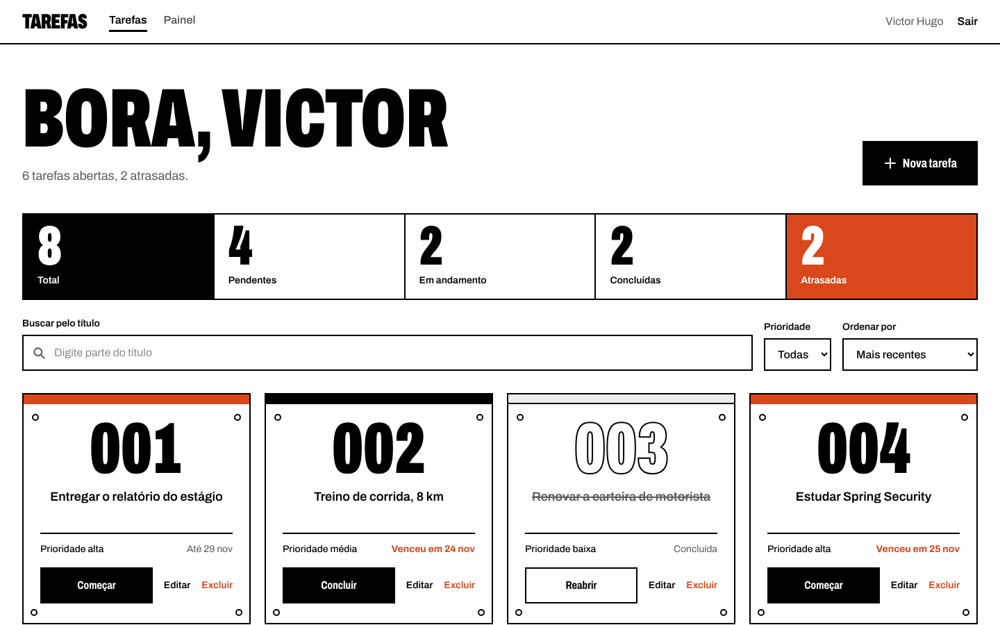
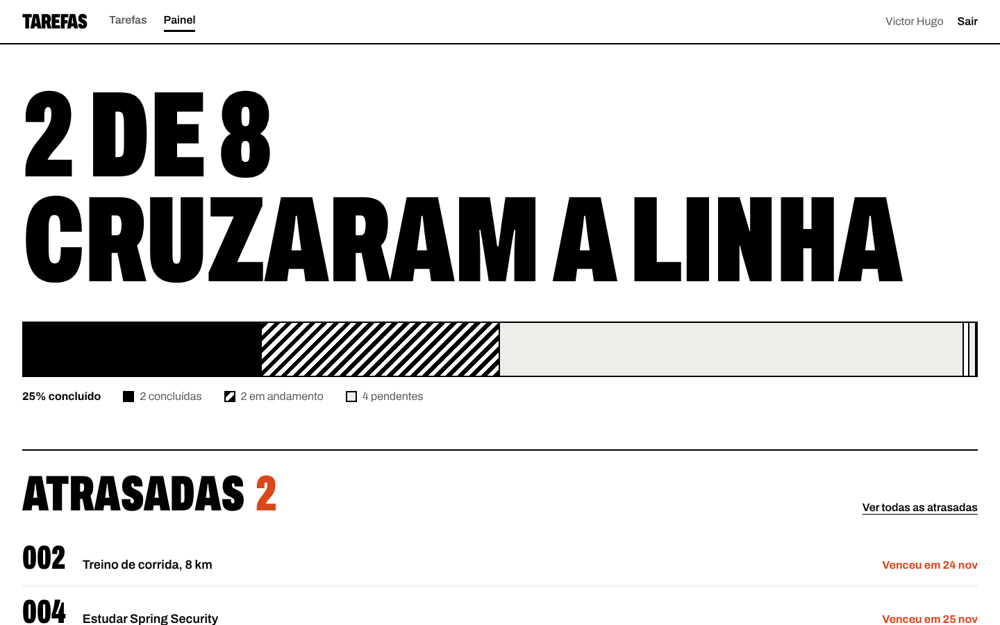
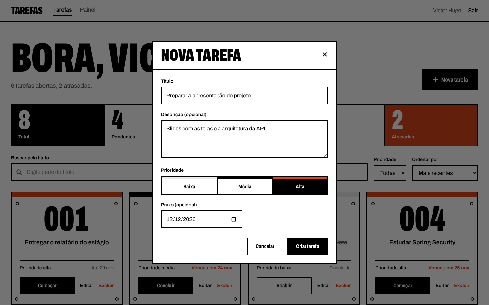
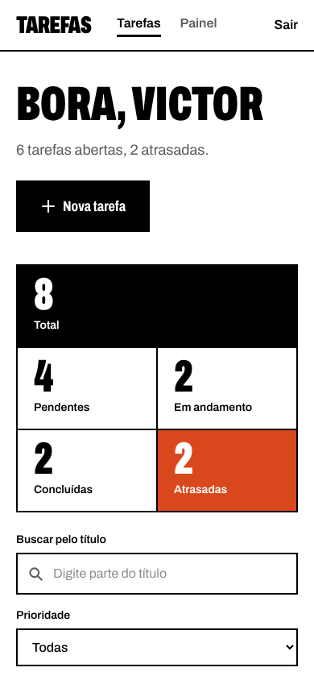

<h1 align="center">✅ API de Tarefas</h1>

<p align="center">
  API REST para gerenciar tarefas pessoais, com cadastro, login por token JWT, prioridades, prazos, filtros e um resumo do que está atrasado. Cada usuário só enxerga as próprias tarefas.
  Acompanha um front-end em React em que cada tarefa vira um número de peito de corrida.
</p>

<p align="center">
  
  
  
  
  
  
  
</p>

<p align="center">
  <a href="https://github.com/ViktorHSO/api-tarefas/actions/workflows/ci.yml"></a>
</p>

<p align="center">
  
</p>

---

## 📖 Sobre o projeto

Projeto pessoal para praticar o desenvolvimento de uma API em Java do jeito que se faz no mercado: camadas bem separadas, autenticação sem sessão, banco versionado com migrations, testes de integração e tudo rodando com um comando no Docker.

O front-end foi pensado como uma corrida: cada tarefa é um **número de peito**, o painel mostra quantas já **cruzaram a linha** e o que está atrasado fica em laranja. O visual usa tipografia condensada bem grande, preto e branco e uma cor de destaque só, com referência em sites de marcas esportivas.

## 🖼️ Telas

| Tarefas | Painel |
|---|---|
|  |  |

| Nova tarefa | Celular |
|---|---|
|  |  |

## 🚀 Funcionalidades

- ✅ Cadastro e login com **JWT** (a senha é guardada só como hash **BCrypt**)
- ✅ CRUD de tarefas com título, descrição, **prioridade** (`BAIXA`, `MEDIA`, `ALTA`) e **prazo**
- ✅ Status `PENDENTE` → `EM_ANDAMENTO` → `CONCLUIDA`, com a data de conclusão registrada automaticamente
- ✅ Tarefas **atrasadas** calculadas pelo prazo (e que deixam de estar atrasadas ao serem concluídas)
- ✅ Listagem com **filtros** (status, prioridade, só atrasadas), **busca** pelo título, **paginação** e **ordenação**
- ✅ **Resumo** com a quantidade de tarefas por status e quantas estão atrasadas
- ✅ Cada usuário acessa só as próprias tarefas: a tarefa de outra pessoa responde `404`, como se não existisse
- ✅ Erros no padrão **Problem Details (RFC 9457)**, com a mensagem de cada campo inválido
- ✅ Documentação interativa com **Swagger**
- ✅ **Testes** de unidade e de integração rodando no **GitHub Actions**, mais um teste do fluxo completo com MySQL no Docker

**No front-end:**

- ✅ Login, cadastro (com confirmação de senha e botão para mostrar a senha) e rotas protegidas, voltando para o login quando o token expira
- ✅ Placar com o resumo das tarefas, que também serve de filtro
- ✅ Lista de tarefas com filtros, busca, ordenação e paginação guardados na URL (dá para compartilhar o link de um filtro)
- ✅ Criar e editar tarefas numa janela, mudar o status e excluir com confirmação
- ✅ Painel com o progresso geral e as tarefas atrasadas mais antigas
- ✅ Ilustrações e ícones em SVG feitos no código e paralaxe na página inicial, só com CSS
- ✅ Responsivo, navegável pelo teclado e respeitando a opção de reduzir animações do sistema

## 🛠️ Tecnologias

- **Java 21** e **Spring Boot 4.2**
- **Spring Web MVC**, **Spring Data JPA** (Hibernate) e **Bean Validation**
- **Spring Security** com OAuth2 Resource Server (tokens JWT assinados com HS256)
- **Flyway** para as migrations do banco
- **MySQL** (Docker) e **H2** em memória (desenvolvimento e testes)
- **springdoc-openapi** (Swagger UI)
- **JUnit 5**, **MockMvc** e **AssertJ**
- **Docker**, **Docker Compose** e **GitHub Actions**
- Front-end: **React 19**, **TypeScript**, **Vite**, **Tailwind CSS**, **React Router**, **TanStack Query**, **Vitest** e **Testing Library**, servido pelo **nginx** no Docker

## 📂 Estrutura

```
src/main/java/io/github/viktorhso/tarefas/
├── auth/       # cadastro, login e geração do token JWT
├── config/     # segurança, JWT, relógio da aplicação e Swagger
├── erro/       # exceções e tratamento global de erros (Problem Details)
├── tarefa/     # entidade, regras, repositório, serviço e controller das tarefas
└── usuario/    # entidade e repositório de usuários
src/main/resources/
├── application.yml
└── db/migration/   # scripts do Flyway
src/test/java/...   # testes de unidade e de integração
frontend/src/
├── api/          # cliente HTTP, chamadas da API e consultas com React Query
├── auth/         # sessão com o token JWT e rotas protegidas
├── componentes/  # número de peito, placar, formulário, ilustrações em SVG, botões e campos
└── paginas/      # início, login, cadastro, tarefas, painel e 404
```

## ⚙️ Como rodar

### Com Docker (MySQL)

```bash
copy .env.example .env     # Windows (Mac/Linux: cp .env.example .env)
# preencha o JWT_SECRET no .env (o comando para gerar está no próprio arquivo)
docker compose up --build
```

Sobem o MySQL, a API em `http://localhost:8080` e o site em **`http://localhost:3000`**. O nginx do site repassa `/api` para a API, então não é preciso configurar CORS.

### Sem Docker (H2 em memória)

Precisa do **JDK 21**. Na pasta do projeto:

```bash
mvnw spring-boot:run       # Windows (Mac/Linux: ./mvnw spring-boot:run)
```

Ou abra no **IntelliJ IDEA** e rode a classe `TarefasApplication`.

Nos dois casos a API sobe em `http://localhost:8080` e a documentação fica em **`http://localhost:8080/swagger-ui.html`**.

### Front-end em modo de desenvolvimento

Com a API rodando na porta 8080 e o **Node 22** instalado:

```bash
cd frontend
npm install
npm run dev
```

O site abre em `http://localhost:5173` e o Vite repassa `/api` para a API.

### Testes

```bash
mvnw test                  # Windows (Mac/Linux: ./mvnw test)
cd frontend && npm test    # testes do front-end
```

## ☁️ Deploy

O projeto roda de graça com três peças:

| Parte | Onde | Por quê |
|---|---|---|
| Banco | [TiDB Cloud Starter](https://tidbcloud.com) | Compatível com MySQL: o Flyway cria as tabelas sem mudar nada |
| API | [Render](https://render.com), serviço web com Docker | Usa o mesmo `Dockerfile` do Docker Compose |
| Site | Render, site estático | O `/api` é repassado para a API, como no nginx e no Vite (sem CORS) |

Tudo isso está descrito no [`render.yaml`](render.yaml).

1. **Banco:** crie um cluster *Starter* no TiDB Cloud. Em **Connect**, gere a senha e anote o host, o usuário (`xxxx.root`) e a senha.
2. **Render:** em **New → Blueprint**, escolha este repositório. O Render lê o `render.yaml` e pede três valores:
   - `DATABASE_URL`: `jdbc:mysql://HOST:4000/tarefas?sslMode=VERIFY_IDENTITY&createDatabaseIfNotExist=true`
   - `DATABASE_USERNAME`: o usuário do TiDB
   - `DATABASE_PASSWORD`: a senha do TiDB

   O `JWT_SECRET` é gerado pelo próprio Render.
3. Espere os dois serviços ficarem no ar. Se o Render der à API um endereço diferente de `api-tarefas-viktorhso.onrender.com`, troque o destino da regra `/api/*` no `render.yaml` (ou em **Redirects/Rewrites** no painel do site).

> No plano gratuito a API dorme depois de 15 minutos sem uso e leva cerca de um minuto para acordar. O site já chama a API assim que abre, para adiantar essa espera.

## 📌 Endpoints

🔒 = exige o cabeçalho `Authorization: Bearer <token>`

| Método | Rota | Descrição |
|---|---|---|
| POST | `/auth/registro` | Cria uma conta |
| POST | `/auth/login` | Faz login e devolve o token JWT |
| GET | `/tarefas` 🔒 | Lista as tarefas (`status`, `prioridade`, `atrasadas`, `busca`, `page`, `size`, `sort`) |
| GET | `/tarefas/resumo` 🔒 | Quantidade por status e de atrasadas |
| GET | `/tarefas/{id}` 🔒 | Busca uma tarefa |
| POST | `/tarefas` 🔒 | Cria uma tarefa |
| PUT | `/tarefas/{id}` 🔒 | Atualiza título, descrição, prioridade e prazo |
| PATCH | `/tarefas/{id}/status` 🔒 | Muda o status |
| DELETE | `/tarefas/{id}` 🔒 | Exclui uma tarefa |

### Exemplo de uso

```bash
# 1. Criar conta
curl -X POST http://localhost:8080/auth/registro -H "Content-Type: application/json" \
  -d '{"nome":"Victor","email":"victor@exemplo.com","senha":"minha-senha-forte"}'

# 2. Fazer login (copie o accessToken da resposta)
curl -X POST http://localhost:8080/auth/login -H "Content-Type: application/json" \
  -d '{"email":"victor@exemplo.com","senha":"minha-senha-forte"}'

# 3. Criar uma tarefa
curl -X POST http://localhost:8080/tarefas -H "Authorization: Bearer SEU_TOKEN" \
  -H "Content-Type: application/json" \
  -d '{"titulo":"Estudar Spring Security","prioridade":"ALTA","prazo":"2026-12-10"}'

# 4. Ver só as tarefas atrasadas de prioridade alta
curl "http://localhost:8080/tarefas?atrasadas=true&prioridade=ALTA" -H "Authorization: Bearer SEU_TOKEN"
```

Resposta de erro de validação:

```json
{
  "type": "about:blank",
  "title": "Dados inválidos",
  "status": 400,
  "detail": "Um ou mais campos têm valores inválidos.",
  "erros": {
    "titulo": "Informe o título.",
    "prioridade": "Informe a prioridade: BAIXA, MEDIA ou ALTA."
  }
}
```

## 💡 Decisões do projeto

- **JWT sem sessão:** a API não guarda estado de login. O token carrega o id do usuário e expira em 60 minutos (configurável).
- **Mesmo erro para e-mail inexistente e senha errada:** evita que alguém descubra quais e-mails têm conta.
- **Tarefa de outro usuário responde 404, não 403:** quem não é dono nem fica sabendo que aquele id existe.
- **Flyway em vez de `ddl-auto`:** o esquema do banco é versionado em SQL e evolui junto com o código.
- **Datas pelo fuso de São Paulo:** o que é "atrasado" depende do dia local, então a aplicação usa um `Clock` com fuso configurável, e não o fuso do servidor.
- **Busca segura:** `%` e `_` digitados na busca são tratados como texto, não como curingas do `LIKE`.
- **Filtros na URL:** o estado da lista fica nos parâmetros da URL, então voltar, recarregar e compartilhar o link mantêm o mesmo filtro.
- **Front e API na mesma origem:** em desenvolvimento o Vite e em produção o nginx repassam `/api`, o que evita configurar CORS.

## 🗺️ Próximos passos

- [ ] Refresh token
- [ ] Etiquetas (tags) para agrupar tarefas
- [ ] Testes com MySQL via Testcontainers
- [x] Deploy

## 👤 Autor

**Victor Hugo Sousa Oliveira**

[GitHub](https://github.com/ViktorHSO)
